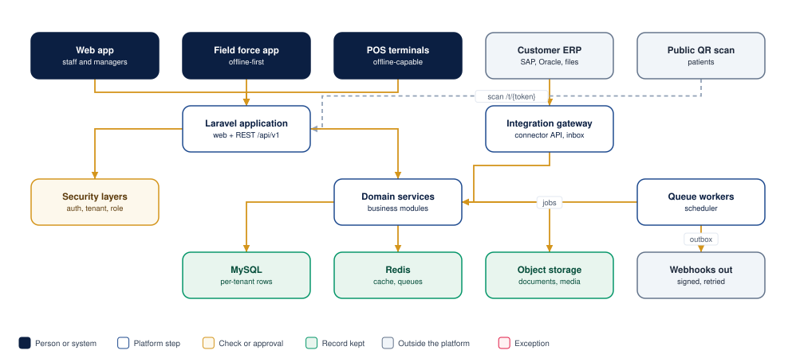
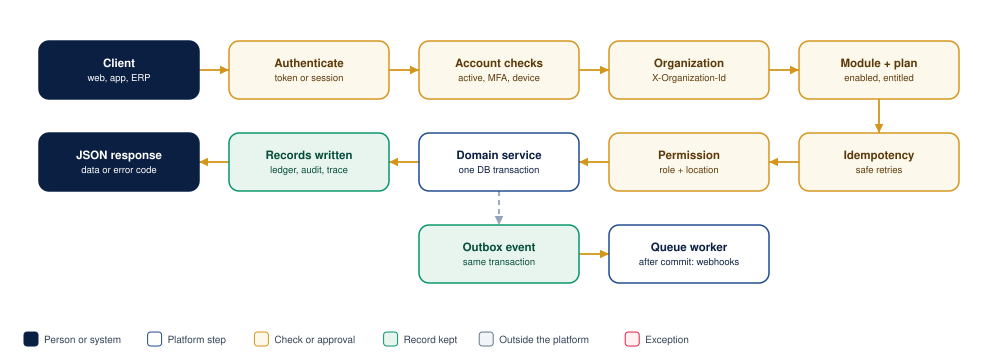
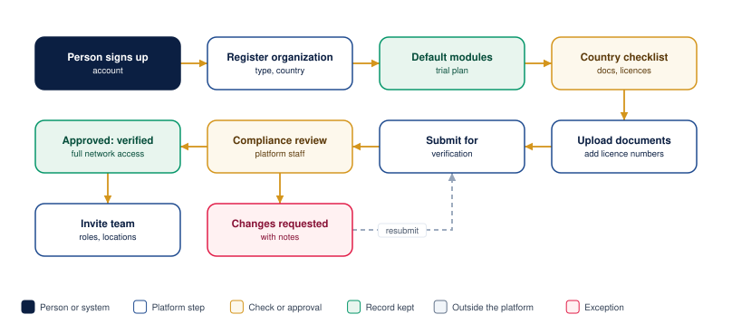
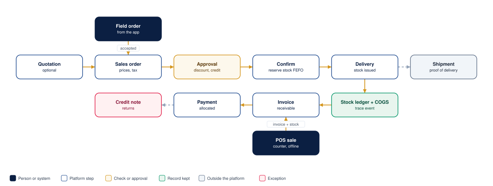
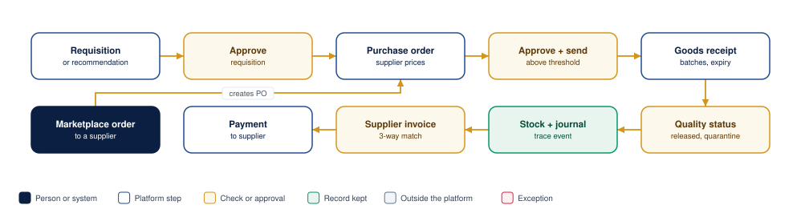
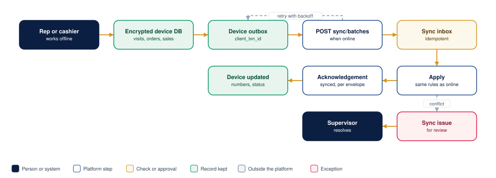
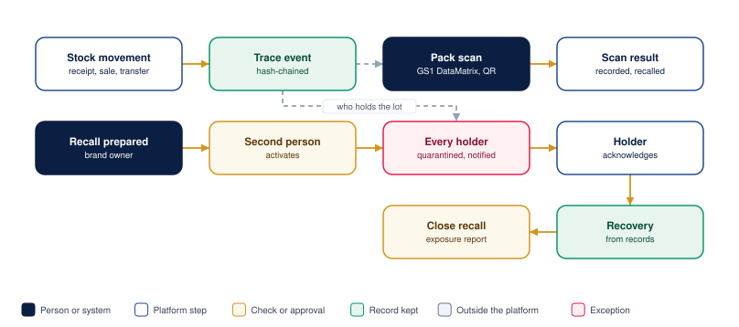
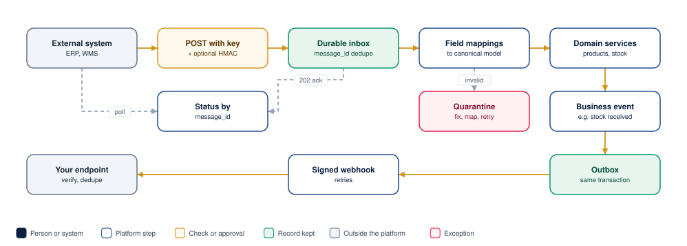
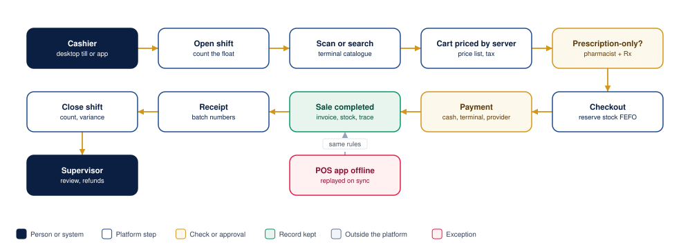

# Application flows

The main flows of the platform, as diagrams with short explanations. Colours: dark boxes are people or systems, white boxes are platform steps, gold boxes are checks or approvals, green boxes are records kept, grey boxes are outside the platform and red boxes are exceptions.

## 1. System architecture

- Web users, the field force app and POS terminals use the same application and API (`/api/v1`).
- Connected systems use the **integration gateway** with their own connector key; members of the public only reach the QR scan page.
- Every request passes the security layers before a domain service runs. Data lives in MySQL (each organization's rows separated), Redis (cache and queues) and object storage (files).
- Queue workers send notifications and webhooks and run scheduled jobs.

## 2. Lifecycle of an API request

1. **Authenticate** the bearer token or web session.
2. **Account checks:** the user is active, two-factor is satisfied when required, the device is not revoked.
3. **Organization:** `X-Organization-Id` must belong to an active organization the user is a member of.
4. **Module and plan:** the module is enabled and the subscription includes it.
5. **Idempotency:** a retried request with the same `Idempotency-Key` replays the stored response instead of acting twice.
6. **Permission:** the user's roles allow the action; location restrictions narrow what is visible.
7. **Domain service:** one database transaction writes the business records, the audit entry, the stock ledger and traceability events, and any outbound event (outbox).
8. **Response:** `{ "data": … }` or an error with a stable code. After commit, workers deliver webhooks and e-mails.

## 3. Organization onboarding and verification

The country checklist depends on the organization's country and type. Compliance staff approve, request changes (the organization fixes and resubmits) or reject. Verification unlocks the marketplace and catalogue proposals.

## 4. Order to cash

- Orders captured in the field app become sales orders once accepted by the sales team; POS sales create their invoice and stock movement at the till.
- Confirmation reserves stock first-expiry-first-out; delivery issues it, posts the cost of goods sold and records a traceability event.
- The invoice creates the receivable; payments are allocated to invoices; returns go through a credit note.
- Shipments track the physical delivery and proof of delivery without posting stock again.

## 5. Procure to pay

Requisitions (or accepted reorder recommendations) become purchase orders; orders above the approval threshold need a second person. The goods receipt records batches, expiry and quality status, posts stock and the journal and records a traceability event. The supplier invoice is matched against the order and the receipt before payment. Marketplace orders create the purchase order automatically.

## 6. Offline capture and synchronization

- Devices keep an encrypted local database and an outbox of changes, each with its own `client_txn_id`.
- When online, the device sends batches; the server stores each envelope once (a resend is recognised) and applies it with the same rules as online work.
- Each envelope is acknowledged individually. Conflicts (for example stock sold elsewhere meanwhile) become **sync issues** for a supervisor rather than silent corrections.

## 7. Traceability and recall

- Every stock movement records a traceability event in the organization's hash-chained ledger; tampering breaks the chain and is detected.
- A pack scan reports what is recorded, never more: "recorded" is not "authenticated".
- A recall prepared by the brand owner (or platform compliance) is activated by a second person. Every holder's stock of the lot is quarantined and the holder is notified; recovery is derived from each holder's records, and the exposure report states its coverage.

## 8. External system integration

- Inbound: the external system posts records with its connector key (and optionally an HMAC signature). Each record is stored once by its `message_id`, mapped to the canonical model and applied; problems go to quarantine for correction. The sender receives `202` immediately and can poll the outcome per `message_id`.
- Outbound: business events are written to the outbox in the same transaction as the change and delivered as signed webhooks with retries.

## 9. Counter sale (POS)

- A cashier sells from the full-screen **POS terminal** in a browser or from the POS app. Both call the same POS API, so prices, tax, discount limits, prescription controls and stock rules are identical.
- The terminal loads its till's catalogue (prices per pack size, prescription classification, stock in its store) once and searches it in the browser for instant scanning; every cart change is priced by the server.
- Prescription-only medicines are sold only by a pharmacist, with the prescription's reference, prescriber and date.
- Checkout reserves stock first expiry first out. When payment covers the total, the sale completes in one transaction: invoice, stock issue with batches, cost of goods sold, cash in the drawer and a traceability event. The receipt lists the batches.
- The shift is closed with a cash count; the difference is reviewed by a supervisor, who also approves refunds and confirms card-terminal payments.
- The desktop terminal needs a connection. The POS app keeps selling offline and its sales are replayed through the same rules when it syncs (section 6).
